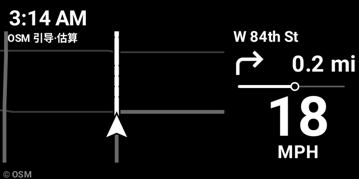
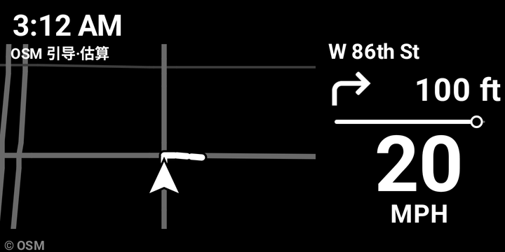
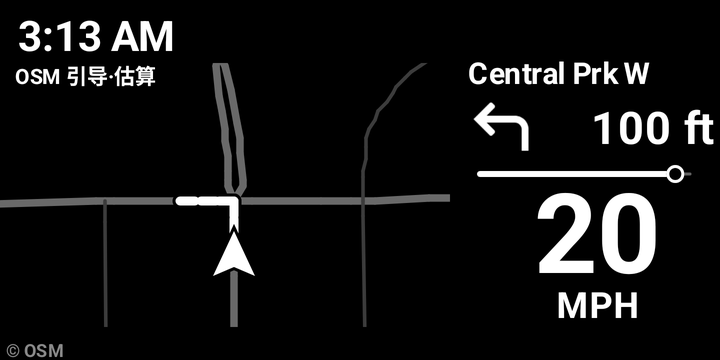
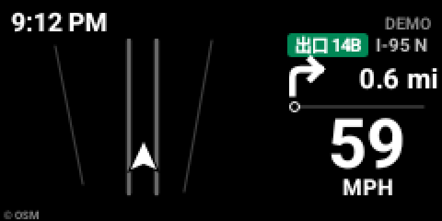
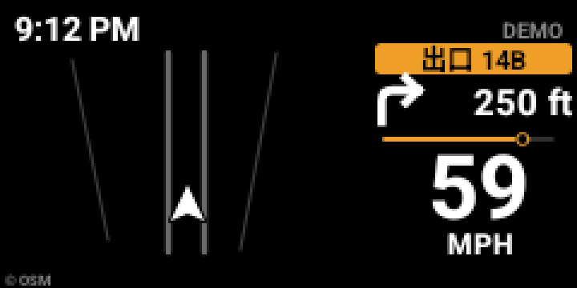
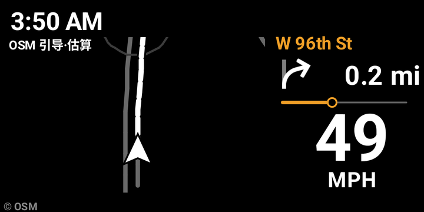
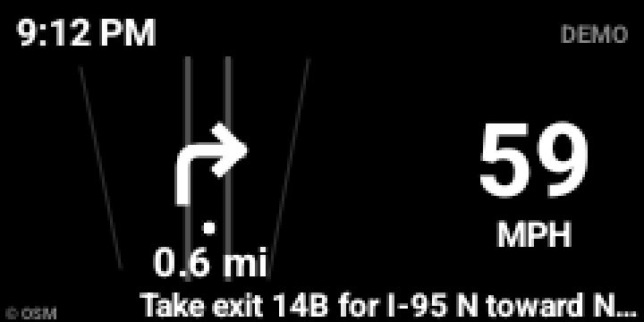
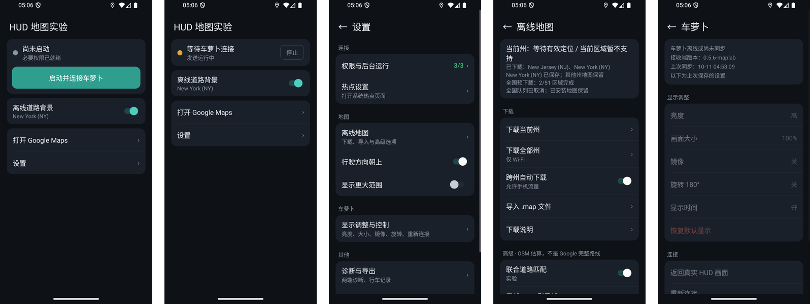
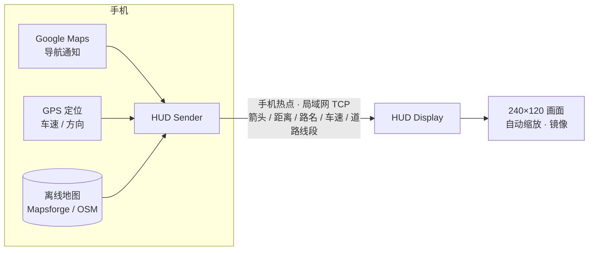

<div align="center">

# C2-M HUD · 把 Google Maps 导航投到抬头显示器

**手机跑 Google Maps，HUD 上显示转弯箭头、距离、路名、车速和离线道路。**
不刷机、不接 OBD、不用原厂 App —— 两个 APK，一部手机加一台安卓 HUD 就能用。

[](https://github.com/baibaipang/c2m-hud-releases/releases)
[](https://github.com/baibaipang/c2m-hud-releases/releases)




<sub>HUD 实际画面（模拟器 240×120 截图，按 3 倍放大）：左边是离线道路与引导线，右边是下一步动作、剩余距离、转弯进度和车速。</sub>

</div>

---

## 目录

- [它能做什么](#它能做什么)
- [HUD 画面](#hud-画面)
- [手机端](#手机端)
- [支持哪些 HUD](#支持哪些-hud)
- [快速开始](#快速开始)
- [工作原理](#工作原理)
- [下载与校验](#下载与校验)
- [常见问题](#常见问题)
- [已知限制](#已知限制)
- [致谢与许可](#致谢与许可)

## 它能做什么

| | 功能 | 说明 |
|---|---|---|
| 🧭 | **Google Maps 转弯提示** | 读取 Google Maps 导航通知，HUD 显示箭头、剩余距离、要拐进的路名 |
| 🚗 | **实时车速** | 来自手机 GPS，大字显示（MPH） |
| 🗺️ | **离线道路背景** | 手机按所在州自动下载离线地图，HUD 上画出周围道路，车头朝上 |
| ➰ | **路口引导线** | 根据导航提示在离线道路上画出到下一个路口的走法（估算，见[已知限制](#已知限制)） |
| 📏 | **转弯进度条** | 最后 1000 ft 按车速平滑推进，比单纯看数字更直观 |
| 🛣️ | **高速出口牌** | 认出 “出口 14B / I-95 N” 等写法；远处绿色，临近变黄提醒 |
| 🔀 | **精简 / 完整一键切换** | 精简＝只有箭头距离车速；完整＝加上地图和引导线。手机与 HUD 两边同步 |
| 🔌 | **自动连接、开机自启** | HUD 连上手机热点后自动配对重连；开机直接进入 HUD 画面 |
| 🪞 | **适配投影** | HUD 上双击进设置：亮度、大小、镜像、旋转 180°、显示时间 |
| 📴 | **离线可用** | 地图下好后，日常行车不需要地图网络服务 |

## HUD 画面

> 下面都是 240×120 原始画面的放大截图。真正投到挡风玻璃上时，黑色部分是透明的。

<table>
  <tr>
    <td align="center"><br><b>右转引导</b><br><sub>引导线沿道路拐进 W 86th St</sub></td>
    <td align="center"><br><b>左转临近</b><br><sub>剩 100 ft，进度条快走满</sub></td>
  </tr>
  <tr>
    <td align="center"><br><b>高速出口（远）</b><br><sub>绿色出口牌 + 高速编号</sub></td>
    <td align="center"><br><b>高速出口（近）</b><br><sub>最后 1000 ft 整行变黄</sub></td>
  </tr>
  <tr>
    <td align="center"><br><b>按道路等级提醒</b><br><sub>通知没写出口号时，靠离线地图判断在高速上</sub></td>
    <td align="center"><br><b>大箭头布局</b><br><sub>另一种排版，适合只看箭头和车速</sub></td>
  </tr>
</table>

<sub>出口牌两张与大箭头一张为测试数据画面（右上角标有 DEMO），其余为模拟器跑真实 Google Maps 路线的截图。画面左上角的 “OSM 引导·估算” 字样在 0.5.11 已去掉。</sub>

## 手机端



<sub>从左到右：首页（未启动）· 首页（等待 HUD 连接）· 设置 · 离线地图 · 远程调整 HUD</sub>

手机端负责所有“重活”：读导航通知、取定位、读离线地图、算引导线；HUD 只负责接收和画图，所以老旧、低配的 HUD 也跑得动。

## 支持哪些 HUD

画面按 240×120 设计，**会按屏幕大小等比缩放**；应用是纯 Java，没有原生库，不挑 CPU。所以大部分能装 APK 的安卓 HUD 都可以试：

| 条件 | 要求 |
|---|---|
| 系统 | Android 5.1（API 22）或更高 |
| 安装 | 能装第三方 APK（文件管理器打开、U 盘或 `adb install` 都行） |
| 网络 | 能连 Wi-Fi（连手机热点） |
| 屏幕 | 横屏；2:1 最合适，其他比例会留黑边 |

| 设备 | 状态 |
|---|---|
| 车萝卜 C2-M（Android 5.1 / ARMv7 / 240×120） | ✅ 主要开发和测试设备 |
| 其他安卓 HUD / 车机 / 旧手机当 HUD | 🟡 按上表条件理论可用，未逐一实测，欢迎在 Issues 反馈 |
| 非安卓 HUD（只能连原厂 App 的那种） | ❌ 装不了 APK，不支持 |

**手机端**：需要 Android 手机和 Google Maps。开发测试用的是 Samsung Galaxy Z Fold7（Android 16）。

## 快速开始

1. **下载**：到 [Releases](https://github.com/baibaipang/c2m-hud-releases/releases) 下载两个 APK
   - `hud-map-display-x.y.z.apk` → 装到 HUD
   - `hud-map-sender-x.y.z.apk` → 装到手机
2. **手机**：打开应用，点 **启动并连接车萝卜**。按提示打开三项必要权限：读取 Maps 导航通知、精确定位、系统 GPS（绿色＝已开，红色＝未开）。
3. **HUD**：连上手机热点，打开 HUD 应用；第一次在手机上确认绑定，以后自动连接。
4. **开导航**：在手机上照常用 Google Maps 导航，HUD 上就会出现转弯提示和车速。
5. **可选**：首页打开 **离线道路背景**，手机会自动下载所在州的地图（几十到几百 MB，可在设置里改成只用 Wi-Fi）。

> 💡 HUD 上**双击**进入设置：调亮度、镜像（投到挡风玻璃上字反了就打开）、旋转 180°、大小、精简/完整画面。手机端 **设置 → 车萝卜** 也能远程调整。

## 工作原理



- 手机只把要画的几十条线段和几个文字发给 HUD，不传整张地图，流量和延迟都很小。
- 两端都不连外部服务器；除了下载离线地图，数据只在手机和 HUD 之间传。

## 下载与校验

| 应用 | 装在哪 | 包名 | 当前版本 |
|---|---|---|---|
| hud-map-display | HUD（车萝卜 C2-M 等） | `com.c2mhud.maplab.display` | 0.5.11 |
| hud-map-sender | 手机 | `com.c2mhud.maplab.sender` | 0.5.11 |

每个安装包的 SHA256 写在 [`version.json`](version.json) 里，下载后核对一致再装：

```powershell
# Windows
certutil -hashfile hud-map-display-0.5.11.apk SHA256
```

```bash
# macOS / Linux
shasum -a 256 hud-map-display-0.5.11.apk
```

> `version.json` 也是以后 HUD 端“检查更新”要读的文件，格式请不要随意改。

## 常见问题

<details>
<summary><b>车速是从 Google Maps 拿的吗？</b></summary>

不是。车速来自手机 GPS，单位 MPH。Google Maps 只提供转弯箭头、距离和路名。
</details>

<details>
<summary><b>地图上的引导线就是 Google 规划的路线吗？</b></summary>

不是。Google Maps 不对外提供完整路线，引导线是根据导航提示在离线 OSM 道路上**估算**出来的，只画到下一个路口。认不准时会停在路口前或不画，不会乱画。
</details>

<details>
<summary><b>没网的时候能用吗？</b></summary>

地图提前下好就行。导航本身仍取决于 Google Maps 能否工作；离线道路背景不需要网络。
</details>

<details>
<summary><b>投到挡风玻璃上字是反的？</b></summary>

在 HUD 上双击进设置，打开“镜像”；方向反了再开“旋转 180°”。
</details>

<details>
<summary><b>需要 OBD、蓝牙或者原厂 App 吗？</b></summary>

都不需要。手机热点 + 两个 APK 即可。
</details>

## 已知限制

- 离线地图目前只覆盖 **美国 50 州和华盛顿特区**；其他地区只显示精简画面（箭头、距离、车速）。
- 引导线、道路等级、“临近高速出口”判断都是基于 OSM 的估算，复杂路口可能不准。
- 定位过期、超出地图范围或附近没有道路时，自动退回精简画面，不挡导航。
- 当前 Release 标为**预发布**：0.5.11 两端已在电脑上构建通过，部分新功能还在等实车确认，详见每个 Release 的说明。

## 致谢与许可

- 地图渲染与离线地图：[Mapsforge](https://github.com/mapsforge/mapsforge)（LGPL-3.0），地图文件来自 [download.mapsforge.org](https://download.mapsforge.org/)
- 道路数据：© [OpenStreetMap](https://www.openstreetmap.org/copyright) 贡献者（ODbL）
- Google Maps 是 Google LLC 的商标；本项目与 Google、车萝卜官方均无关联，仅读取手机上的导航通知。

本仓库只发布安装包和版本说明，源码不在这里。

---

<div align="center"><sub>行车安全第一：请在停车时完成设置，行驶中只看一眼 HUD。</sub></div>
